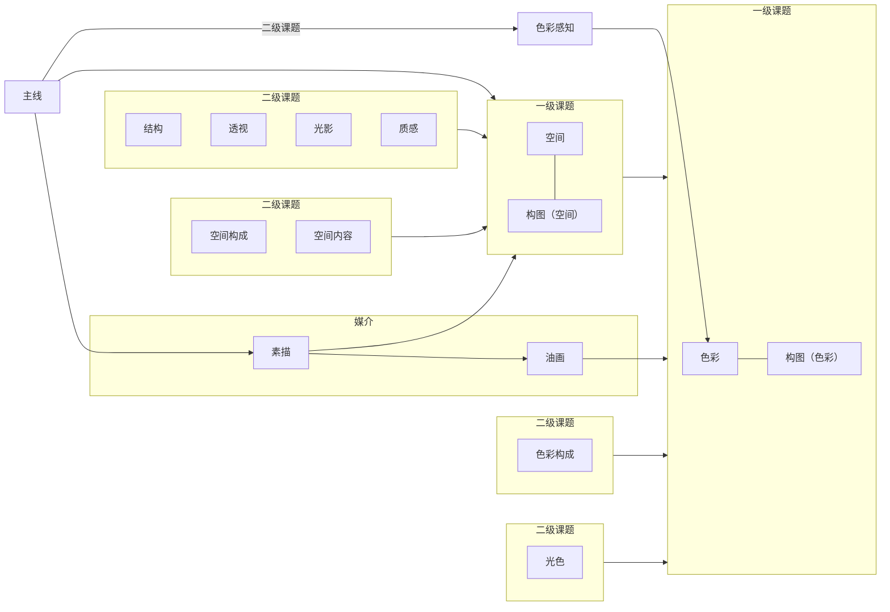

### 一，刻意练习

**方法论**：
1. 理解优先
2. 刻意连接
3. 反复提取

**实践**：
1. 选择小领域（二级课题）
2. 构建知识地图（核心概念的关系图）
3. 主动笔记+输出验证
4. 定期压缩

**运行模式**：

基本功笔记（小领域）
- 理解优先
- 知识地图

输出验证（训练课题）
- 刻意连接
- 反复提取

### 二，递进关系

观察 -> 构图 -> 空间 -> 色彩 -> 创作

（前一个都是很重要的基础）

### 三，学习主线

基于递进关系与学习逻辑，整理一条主线。

两个媒介：
1.素描
2.油画

两个一级课题：
1.空间，空间构图，
2.色彩，色彩构图

空间，空间构图的二级课题：
1.空间构成
2.空间内容
3.结构
4.透视
5.光影
6.质感

色彩，色彩构图：
1.色彩构成
2.色彩感知
3.光色

一个并行二级课题：
1.色彩感知

