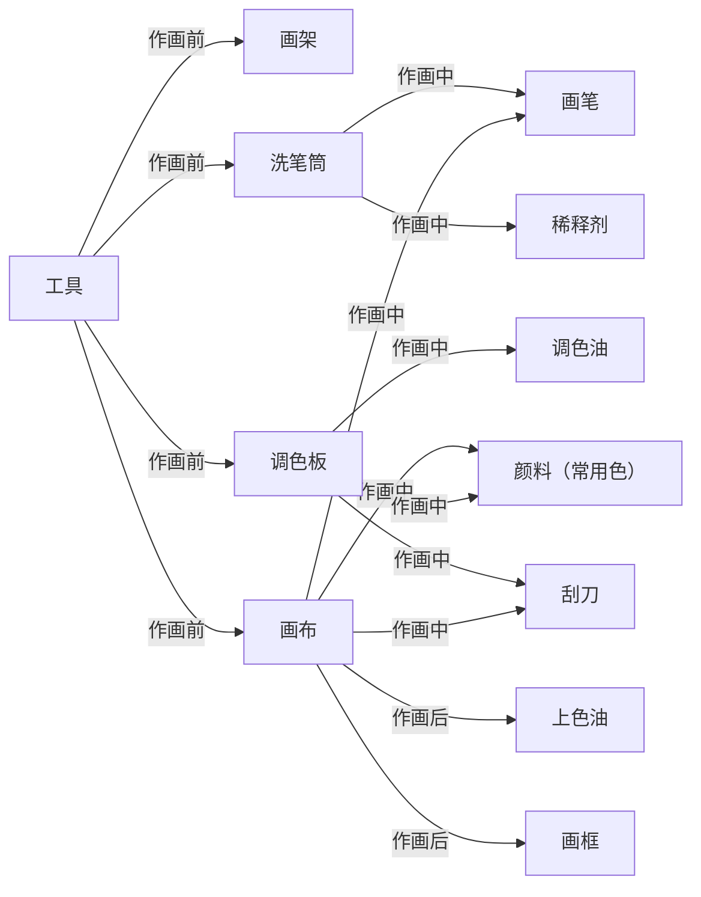

### 零，油画

油画是一门艺术，基于画家对现实，梦境的感知与表达，形成了以造型，色彩，构图为核心组成的理论体系，以及为了实现它们而发展出来的技法。根据三者的不同侧重点，形成了各种具象的流派。最后使用油性颜料及周边工具将它们呈现在画中。

### 一，工具

作画前，需要配置好画架，洗笔筒，调色板，画布。作画中，需要画笔，刮刀，颜料，调色油，稀释剂。作画后，需要上色油，成品框。

#### 1.颜料

基本成分由**颜料粉**与**调色油**（如亚麻籽油）混合研磨而成。

颜料的分类：
1. **传统油画颜料**：慢干，色彩温润通透，适合古典写实和层层罩染。
2. **醇酸树脂油画颜料**：快干，适合快速铺层和户外写生。
3. **水溶油画颜料**：可用水清洗画笔，无需刺激性稀释剂，适合居家创作和初学者。

常用的颜料颜色：
1. 三原色系，深红，土黄，群青
2. 白色系，钛白
3. 黑色系，象牙黑
4. 棕色系，熟褐
5. 补充色系，？

#### 2.油

**调色油**。常用亚麻仁油，加入颜料后留在画面，参与氧化聚合干燥。

**稀释剂**。常用松节油，无味酒精。是挥发性溶剂，不留画面，只负责稀释和清洗。

**上光油**。在油画完成并干透后罩涂上光油，保持画面的光泽度，防止空气侵蚀和积垢。

#### 3.作画工具

**画笔**。用弹性适中的动物毛制成，有硬毛，软毛，各种大小形状，常用：
1. 大号猪鬃平头
2. 中号猪鬃榛形，中号软毛平头，中号软毛榛形
3. 小号软毛圆头，极细勾线笔

**刮刀**。刮刀可用于在调色板上调匀颜料，对画进行修改删除，或者直接用刀作画，常用：
1. 中号菱形调色刀
2. 小号画刀

**画布**。标准的画布，是将亚麻布或帆布紧绷在木质内框上后，用胶或油与白粉掺和并涂刷在布的表面制作而成。常用画框，画板，画布本。

以及常用的：**洗笔筒**，**上光刷**，**调色板**，**画架**，**成品框**。
### 二，理论体系

为了表达出自我对世界的感知，从解决问题的角度出发构建三大理论体系。
#### 1.造型体系

造型体系是油画最基础的底层理论，目的是将三维空间表现在二维画面上，需要解决的问题以及对应的方法论如下：
1. **二维型准**，需要形状感知法，包括：边缘线，轮廓线，正负形。
2. **三维型准**，需要透视学，包括：比例，角度。
3. **结构与动态**，需要解剖学，包括：骨头，肌肉，关节，体块，运动线。
4. **体积感与空间感**，需要明暗法与虚实关系，包括：二分法，明暗交界面，光影。
5. **质感**，需要材质表现法，包括：高光，反光，纹理，笔触。
#### 2.色彩体系

色彩理论的目的是将光色关系、色彩空间与情感表现组织在二维画面上，需要解决的问题以及对应的方法论如下：
1. 色准，需要色彩感知法，包括：色相，明度，纯度，冷暖。
2. 色调统一，需要色调法，包括：主色调，纯度对比，黑白灰。
3. 色彩塑造，需要造型体系。
#### 3.构图

构图的目的是将视觉元素与形式关系组织在二维画面上，需要解决的问题以及对应的方法论如下：
1. 定位，需要基本单位，包括：框架。
2. 视觉中心，需要主次，虚实关系，包括：。
3. 节奏，需要动势法，组织法，包括：方向，视线，路径，疏密，间隔。
4. 空间层次，需要层次法，包括：前景，中景，背景，遮挡，透视，空气远近。
### 三，技法

按作画逻辑，分成四个大阶段。大部分直接画法（湿画法），调整时采用少部分间接画法（罩染）。
#### 1.起型
#### 2.铺色
#### 3.深入
#### 4.调整

### 四，题材

动物，静物，风景，梦境

### 五，具象流派

油画的流派分为两大类。第一类是以客观的再现为主的创造性作品；第二类是以主观表现为主的创造性作品。该节关注具象的流派。
#### 1.客观再现

**古典主义与学院派**。古典主义是以尊重古希腊、罗马的审美原则，构图上对称、均衡，气势上庄严、辉煌、崇高向上，技法纯熟，刻画深入。这也是学院派的奉行的原则。正如学院派奠基者法契诺所讲“美是所有艺术品的最高目标，它是事物的一种客观性质，由秩序、和谐、比例、规矩所组成”。其代表作家有拉斐尔、安格尔等等。

**浪漫主义**。浪漫主义起源于法国19世纪初期，其代表作是籍里柯的《梅杜萨之筏》，在此作品中的构图、光线、色彩、动态、表情都表现了艺术家丰富的想象力，它打破了古典主义的构图中的水平与垂直，光线的柔和与均匀，使画面产生了一种激情。这也是浪漫主义绘画的重要元素，注重感情的宣泄与表达。

**写实主义与照相写实主义**。写实主义就如它的创始人库尔贝在1885年所讲的：“像我所见到的那样，如实地表现我这个时代的风俗，思想和它的面貌。一句话，创造艺术就是我的目的”。照相写实主义是对生活以一种照片式的形式搬上画面，如克洛斯的《约翰像》。它绘制作品要先拍成照片或幻灯片，再把它以比真人大十倍的比例精细地放大到布上，更细腻、更逼真地表现出对象的细节，如脸上的每一丝肌理和每根汗毛等。

**印象主义**。印象主义是19世纪的画家们走出了自己的画室，去探索自然界中光与色的瞬间变化，打破了传统观念上固有色的概念，如树是兰绿色、阴影是黑色，它把周围的环境色对固有色的影响进行了客观的绘制。其代表画家有莫奈、修拉、塞尚、雷诺阿等。
#### 2.主观表现

**后印象主义**。后印象主义画家强调表现自我感受，注重色彩的对比和事物的内在结构，其代表画家有凡高、高更等。这个画派对现代西方绘画产生了深远的影响。

**超现实主义**。超现实主义画派受柏格森的直觉主义及弗洛伊德的潜意识学说的影响，主张表现人的潜意识和梦幻。代表画家有西班牙画家达利、米罗。

