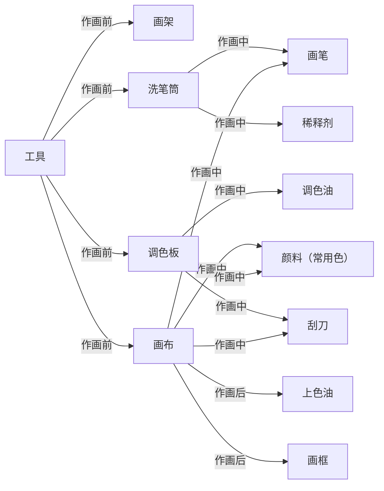
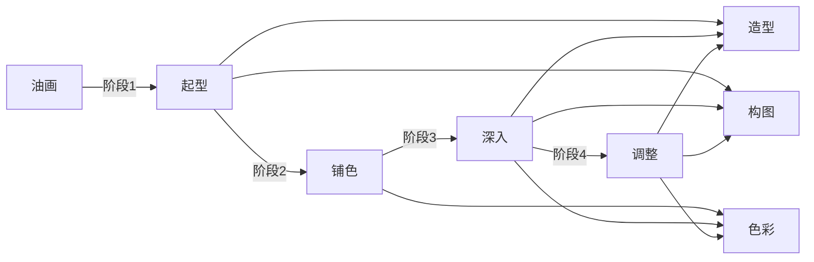

### 一，工具

作画前，需要配置好画架，洗笔筒，调色板，画布。作画中，需要画笔，刮刀，颜料，调色油，稀释剂。作画后，需要上色油，成品框。

#### 1.颜料

基本成分由**颜料粉**与**调色油**（如亚麻籽油）混合研磨而成。

颜料的分类：
1. **传统油画颜料**：慢干，色彩温润通透，适合古典写实和层层罩染。
2. **醇酸树脂油画颜料**：快干，适合快速铺层和户外写生。
3. **水溶油画颜料**：可用水清洗画笔，无需刺激性稀释剂，适合居家创作和初学者。

常用的颜料颜色：
1. 三原色系，深红，土黄，群青
2. 白色系，钛白
3. 黑色系，象牙黑
4. 棕色系，熟褐
5. 补充色系，？

#### 2.油

**调色油**。常用亚麻仁油，加入颜料后留在画面，参与氧化聚合干燥。

**稀释剂**。常用松节油，无味酒精。是挥发性溶剂，不留画面，只负责稀释和清洗。

**上光油**。在油画完成并干透后罩涂上光油，保持画面的光泽度，防止空气侵蚀和积垢。

#### 3.作画工具

**画笔**。用弹性适中的动物毛制成，有硬毛，软毛，各种大小形状，常用：
1. 大号猪鬃平头
2. 中号猪鬃榛形，中号软毛平头，中号软毛榛形
3. 小号软毛圆头，极细勾线笔

**刮刀**。刮刀可用于在调色板上调匀颜料，对画进行修改删除，或者直接用刀作画，常用：
1. 中号菱形调色刀
2. 小号画刀

**画布**。标准的画布，是将亚麻布或帆布紧绷在木质内框上后，用胶或油与白粉掺和并涂刷在布的表面制作而成。常用画框，画板，画布本。

以及常用的：**洗笔筒**，**上光刷**，**调色板**，**画架**，**成品框**。

### 二，技法

按作画逻辑，分成四个大阶段。大部分直接画法（湿画法），调整时采用少部分间接画法（罩染）。
#### 1.起型

**目的**：
确定构图、比例、透视、动态和大形。

**方法**：
用单色薄涂或线稿，先定大位置、大结构，不抠细节。

**理论基础**：
构图，造型。
#### 2.铺色

**目的**：
建立整体色调、黑白灰和冷暖关系。

**方法**：
大笔薄涂，概括色块，趁湿衔接，保持整体。

**理论基础**：
色彩。
#### 3.深入

**目的**：
塑造体积、结构、质感、空间和细节，同时不破坏整体。

**方法**：
压暗提亮，丰富色彩，局部塑造，并不断与整体比较。

**理论基础**：
造型，色彩，构图。
#### 4.调整

**目的**：
回到整体，统一色调、明暗、冷暖、虚实和主次。

**方法**：
远看、眯眼、对比，加强或减弱；少部分罩染统一画面。

**理论基础**：
造型，色彩，构图。

### 三，具象流派

油画的流派分为两大类。第一类是以客观再现为主；第二类是以主观表现为主。
#### 1.客观再现

**参照世界**：
- 文艺复兴时期
- 古典派，新古典派，学院派
- 写实主义
- 印象主义
#### 2.主观表现

**创造世界**：
- 巴洛克艺术
- 洛可可艺术
- 浪漫主义